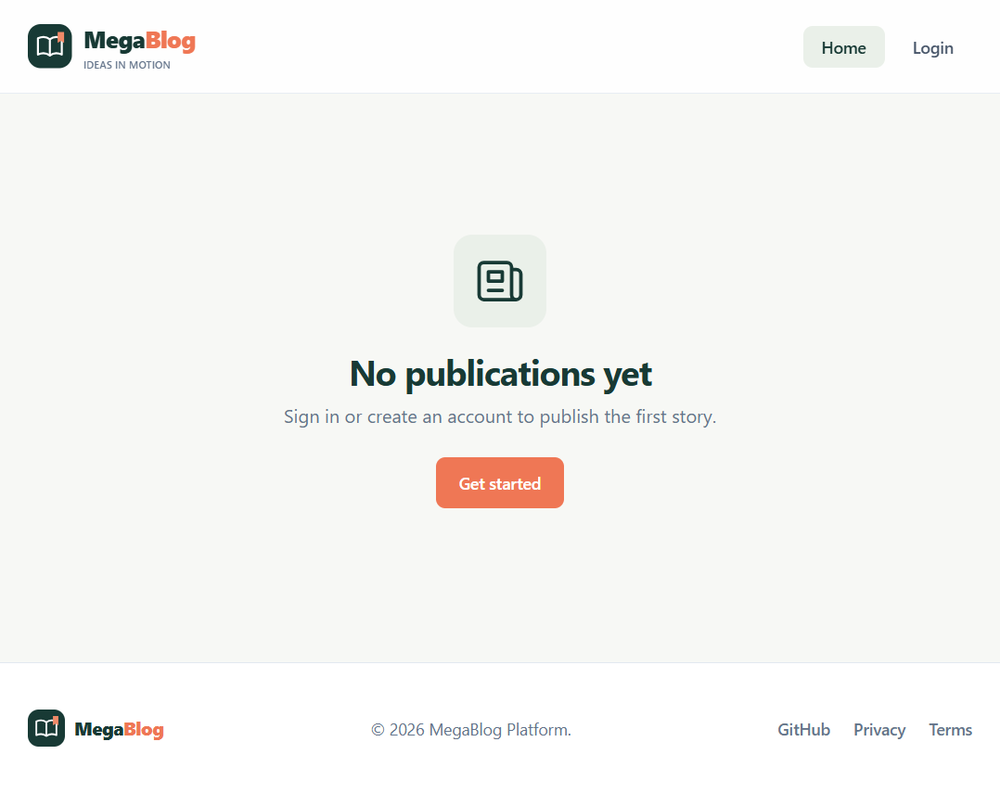
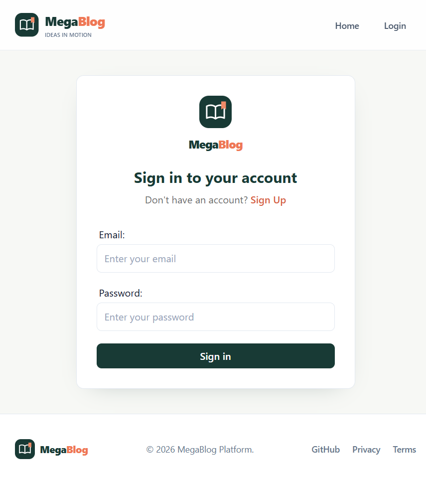
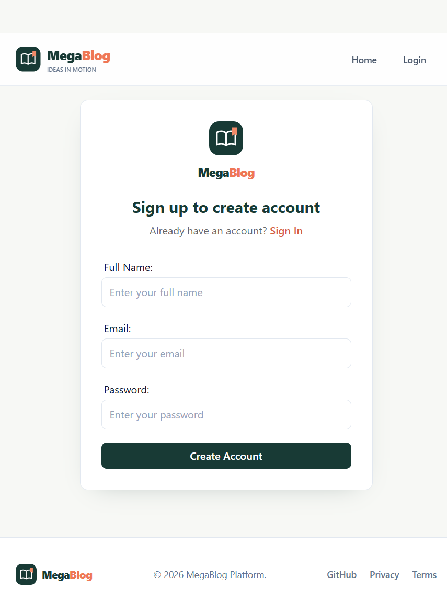

# MegaBlog

MegaBlog is a React blogging app where visitors can browse and read articles, and signed-in users can create and manage posts. The app uses Appwrite for authentication, database storage, and featured-image uploads.

## Features

- Public home page with the latest articles and a signup prompt for prospective writers.
- Article pages that visitors can read without signing in.
- Account creation, sign-in, and sign-out with Appwrite.
- Create and edit posts with a rich-text editor, featured image, and publication status.
- Responsive layout for mobile and desktop.

## Screenshots

The home page below shows MegaBlog's current no-publications empty state.

<p align="center">
  
</p>

<table>
  <tr>
    <td align="center"></td>
    <td align="center"></td>
  </tr>
  <tr>
    <td align="center">Sign in</td>
    <td align="center">Sign up</td>
  </tr>
</table>

## Requirements

- Node.js and npm.
- An Appwrite project with an endpoint, project, database, collection, and storage bucket.
- A TinyMCE API key for the rich-text editor.

## Getting started

1. Install the project dependencies:

   ```bash
   npm install
   ```

2. Create a local environment file by copying the sample:

   ```powershell
   Copy-Item .env.sample .env
   ```

   Or copy `.env.sample` to `.env` using your operating system's file manager.

3. Fill in the Appwrite and TinyMCE values in `.env`:

   ```dotenv
   VITE_APPWRITE_URL="https://cloud.appwrite.io/v1"
   VITE_APPWRITE_PROJECT_ID="your-project-id"
   VITE_APPWRITE_DATABASE_ID="your-database-id"
   VITE_APPWRITE_COLLECTION_ID="your-posts-collection-id"
   VITE_APPWRITE_BUCKET_ID="your-images-bucket-id"
   VITE_TINYMCE_API_KEY="your-tinymce-api-key"
   ```

   Use the Appwrite endpoint and IDs for your own project. Add the local development origin (usually `http://localhost:5173`) and any deployed site origins to your Appwrite project's **Platforms**.

4. Start the development server:

   ```bash
   npm run dev
   ```

   Open the local URL printed by Vite in your browser.

## Appwrite setup

Create a database collection for posts with attributes matching the data used by the app:

| Attribute | Purpose |
| --- | --- |
| `title` | Article title |
| `content` | Rich-text article content |
| `featuredImage` | ID of the uploaded image in Appwrite Storage |
| `status` | Publication status (`active` or `inactive`) |
| `userId` | ID of the user who created the post |

The post slug is used as the Appwrite document ID, so ensure document IDs can be set by the client. Configure collection access so visitors can read articles and signed-in users can create posts. Set update and delete permissions according to your access-control policy.

Post submission uploads its featured image to the bucket configured by `VITE_APPWRITE_BUCKET_ID`. In the Appwrite Console, open **Storage**, select that bucket, and grant **Create** permission to authenticated users. To display article images to logged-out visitors, also allow public read access to the images. Do not grant **Create** to **Any** unless unauthenticated uploads are intended. Bucket permissions are enforced by Appwrite and cannot be granted by the browser client.


## Main routes

| Route | Access | Description |
| --- | --- | --- |
| `/` | Public | Browse articles and discover how to get started writing |
| `/post/:slug` | Public | Read an article |
| `/login` | Signed out | Sign in |
| `/signup` | Signed out | Create an account |
| `/all-posts` | Signed in | Browse posts |
| `/add-post` | Signed in | Create a post |
| `/edit-post/:slug` | Signed in | Edit a post |

## Tech stack

- React and Vite
- React Router
- Redux Toolkit
- Appwrite
- Tailwind CSS
- TinyMCE
